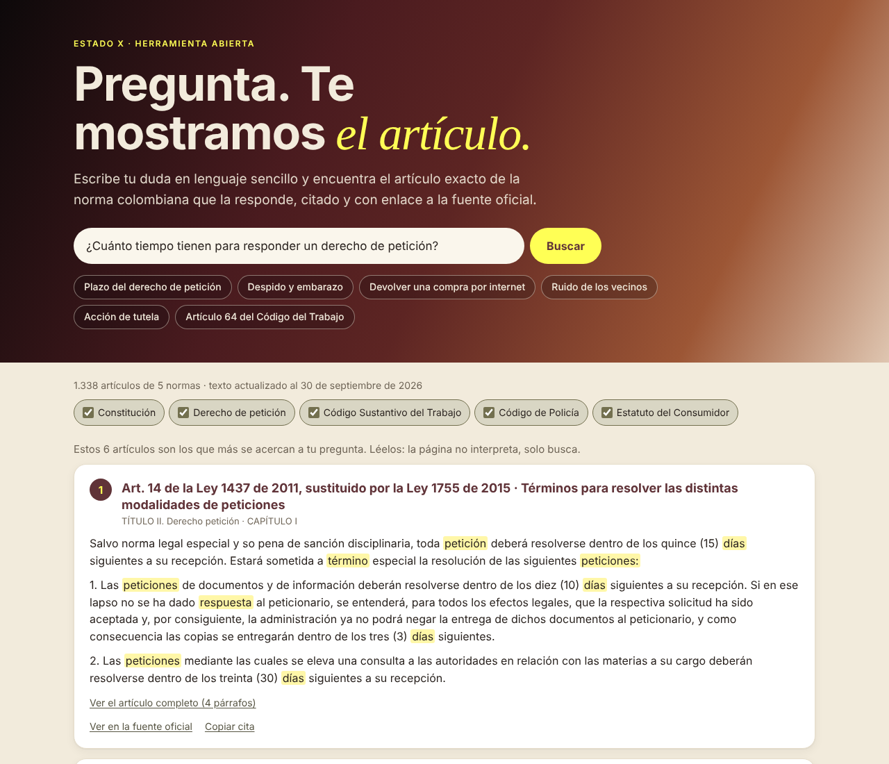

# Normas de Colombia, citadas

**[Español](#español) · [English](#english)**

## Español

Escribe tu pregunta en lenguaje sencillo y encuentra **el artículo exacto** de la norma colombiana que la responde, citado y con enlace a la fuente oficial. Luego, si quieres, llévalo a tu IA con la instrucción de responder **solo con esos artículos**.

**Ábrelo aquí:** https://estado-x.github.io/normas-colombia/

### Qué hace

- Busca en **1.338 artículos** de cinco normas: la Constitución Política (con sus reformas y artículos transitorios), el derecho de petición (artículos 13 a 33 de la Ley 1437 de 2011, como los dejó la Ley 1755 de 2015), el Código Sustantivo del Trabajo, el Código de Policía (Ley 1801 de 2016) y el Estatuto del Consumidor (Ley 1480 de 2011).
- Entiende palabras de la vida diaria: «despido», «requisa», «devolver una compra», «ruido de los vecinos».
- Reconoce referencias directas: «artículo 64 código del trabajo», «art 23».
- Muestra hasta seis artículos con su cita, su ubicación en la norma, las palabras encontradas resaltadas, la anotación de la Secretaría del Senado cuando el artículo fue modificado, y el enlace a la fuente oficial.
- **Llévalo a tu IA:** arma un texto para pegar en Claude o en ChatGPT que pide responder solo con esos artículos, citar cada afirmación y decir cuándo no alcanzan.

### Cómo funciona

- Es una página estática (HTML, CSS y JavaScript) publicada con GitHub Pages. No tiene servidor, base de datos, claves ni rastreo. La búsqueda ocurre en tu navegador.
- `scripts/armar_corpus.py` baja las normas de la Base Documental de la Secretaría General del Senado y las guarda artículo por artículo en `data/normas.json`. Si una norma falla, conserva la versión anterior de esa norma.
- La búsqueda usa BM25 (un método clásico de recuperación de información) con una raíz sencilla de las palabras en español y una lista de sinónimos de la vida diaria (`assets/sinonimos.js`).
- El flujo **Actualizar normas** de GitHub Actions vuelve a bajar el texto una vez al mes y solo guarda si algo cambió.

### Úsalo o adáptalo

1. Haz un fork de este repositorio.
2. Activa GitHub Pages (Settings → Pages → rama `main`, carpeta raíz) y GitHub Actions.
3. Para actualizar el texto: corre el flujo **Actualizar normas** desde la pestaña Actions, o en tu computador `python scripts/armar_corpus.py` (biblioteca estándar de Python 3.9 o superior) y luego `python -m http.server`.

¿Otra norma? Agrégala a la lista `NORMAS` de `scripts/armar_corpus.py` con el nombre de su página en la Base Documental del Senado. ¿Más sinónimos? Edita `assets/sinonimos.js`.

### Límites

- **No es asesoría legal.** La página busca artículos por palabras; no interpreta tu caso.
- No trae jurisprudencia, decretos reglamentarios ni conceptos, que pueden cambiar cómo se aplica un artículo.
- Toma el texto de los artículos y las anotaciones cortas entre < > de la Secretaría del Senado (por ejemplo, «Artículo modificado por…»). No toma las notas de vigencia, concordancias, jurisprudencia ni antecedentes de su compilación.
- En el Código Sustantivo del Trabajo, la Secretaría marca entre llaves los términos actualizados (por ejemplo, {empleadores}); aquí se muestran sin las llaves.
- La búsqueda puede dejar por fuera un artículo relevante si la pregunta usa palabras muy distintas a las de la norma. Revisa siempre la fuente oficial.

### Crédito

Inspirado en **[LawGlance](https://github.com/lawglance/lawglance)** (licencia Apache-2.0): la idea de un asistente que responde con la norma citada. Este repositorio es una versión nueva, escrita desde cero y pensada para Colombia, que funciona sin servidor ni claves. No reutiliza código de LawGlance.

Texto de las normas: [Secretaría General del Senado de la República, Base Documental](http://www.secretariasenado.gov.co/senado/basedoc/). La Ley 23 de 1982, artículo 41, permite reproducir la Constitución, las leyes y los decretos, ajustándose a la edición oficial.

Hecho por **[Estado X](https://estadox.com)** · Código con licencia MIT.

---

## English

Type your question in plain Spanish and find **the exact article** of Colombian law that answers it, cited and linked to the official source. Then, if you want, take it to your AI with the instruction to answer **only from those articles**.

**Open it here:** https://estado-x.github.io/normas-colombia/

### What it does

- Searches **1,338 articles** from five laws: the Political Constitution (with its amendments and transitional articles), the right of petition (articles 13–33 of Law 1437 of 2011, as replaced by Law 1755 of 2015), the Labor Code, the Police Code (Law 1801 of 2016) and the Consumer Statute (Law 1480 of 2011).
- Understands everyday words such as «despido» (dismissal), «requisa» (stop and search), «devolver una compra» (return a purchase) or «ruido de los vecinos» (noisy neighbors).
- Recognizes direct references: «artículo 64 código del trabajo», «art 23».
- Shows up to six articles with their citation, their place in the law, matched words highlighted, the Senate's short note when an article was amended, and the link to the official source.
- **Take it to your AI:** builds a text to paste into Claude or ChatGPT asking it to answer only from those articles, cite every statement and say when they are not enough.

### How it works

- It is a static page (HTML, CSS and JavaScript) published on GitHub Pages. No server, database, API keys or tracking. Search runs in your browser.
- `scripts/armar_corpus.py` downloads the laws from the Colombian Senate's document database and stores them article by article in `data/normas.json`. If one law fails, it keeps the previous version of that law.
- Search uses BM25 (a classic information-retrieval method) with a simple Spanish word stemmer and an everyday-synonyms list (`assets/sinonimos.js`).
- The **Actualizar normas** GitHub Actions workflow downloads the text again once a month and only commits when something changed.

### Use it or adapt it

1. Fork this repository.
2. Turn on GitHub Pages (Settings → Pages → branch `main`, root folder) and GitHub Actions.
3. To refresh the text: run the **Actualizar normas** workflow from the Actions tab, or locally `python scripts/armar_corpus.py` (Python 3.9+ standard library only), then `python -m http.server`.

Another law? Add it to the `NORMAS` list in `scripts/armar_corpus.py` with its page name in the Senate's document database. More synonyms? Edit `assets/sinonimos.js`.

### Limits

- **This is not legal advice.** The page finds articles by their words; it does not interpret your case.
- It does not include case law, regulatory decrees or official opinions, which can change how an article applies.
- It takes the article text and the Senate's short notes in < > (for example, «Article amended by…»). It does not take the validity notes, cross-references, case law or legislative history from the Senate's compilation.
- In the Labor Code, the Senate marks updated terms in braces (for example, {empleadores}); they are shown here without the braces.
- Search can miss a relevant article if the question uses very different words from the law. Always check the official source.

### Credit

Inspired by **[LawGlance](https://github.com/lawglance/lawglance)** (Apache-2.0 license): the idea of an assistant that answers with the cited law. This repository is a new version, written from scratch for Colombia, that works with no server or keys. It does not reuse LawGlance code.

Legal text: [Colombian Senate General Secretariat, document database](http://www.secretariasenado.gov.co/senado/basedoc/). Law 23 of 1982, article 41, allows anyone to reproduce the Constitution, laws and decrees, as long as they follow the official edition.

Made by **[Estado X](https://estadox.com)** · Code under the MIT license.
